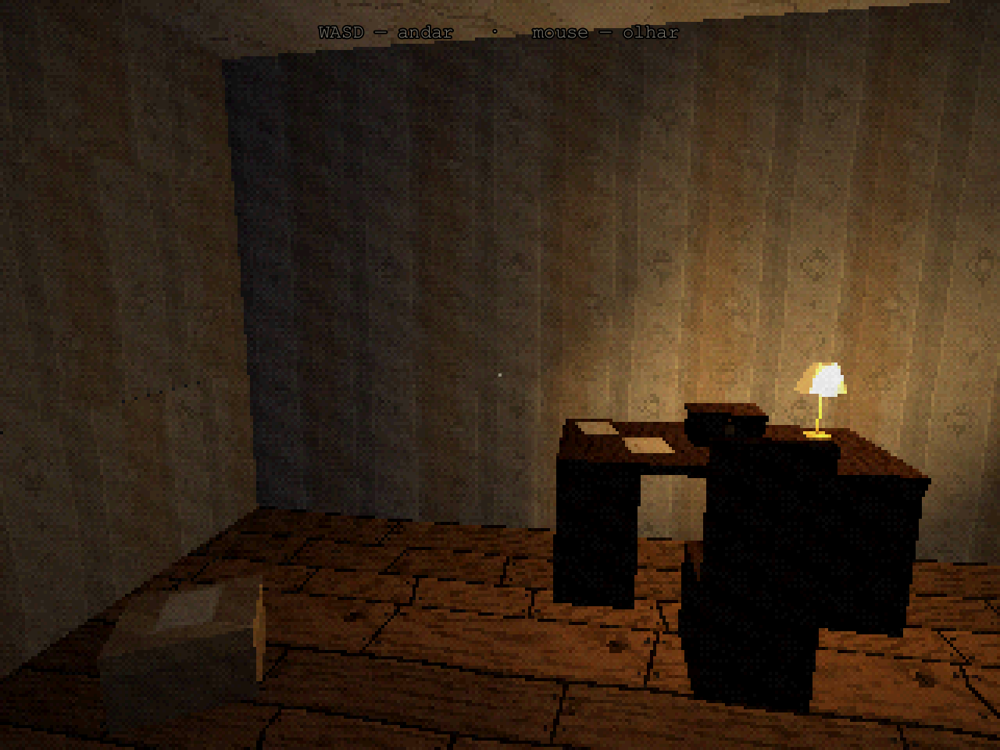
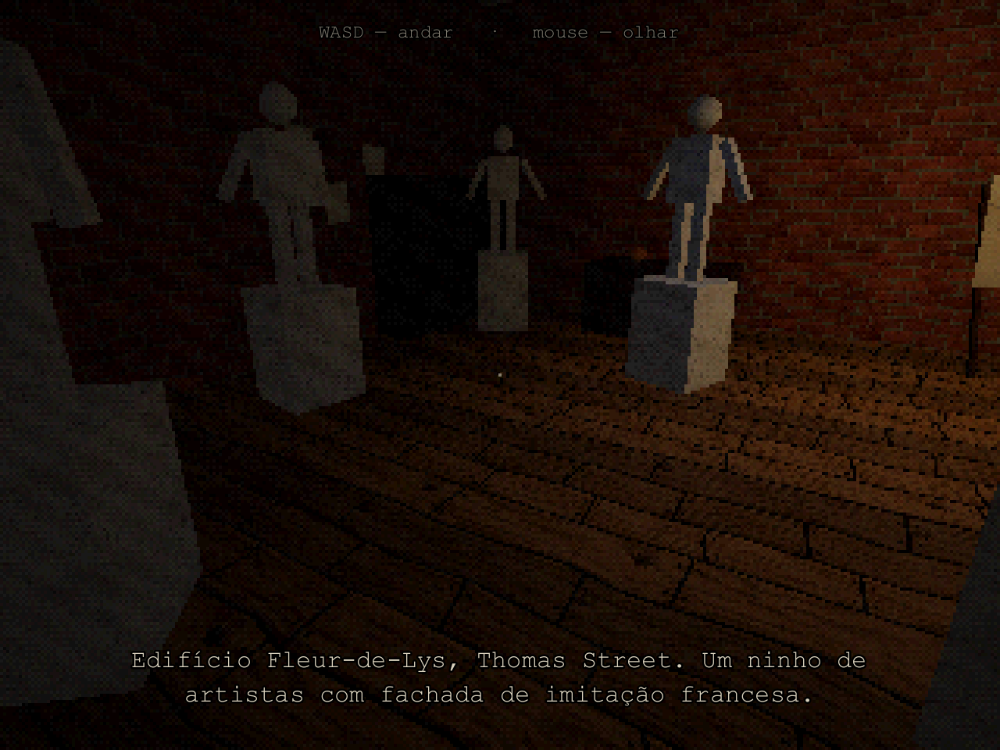
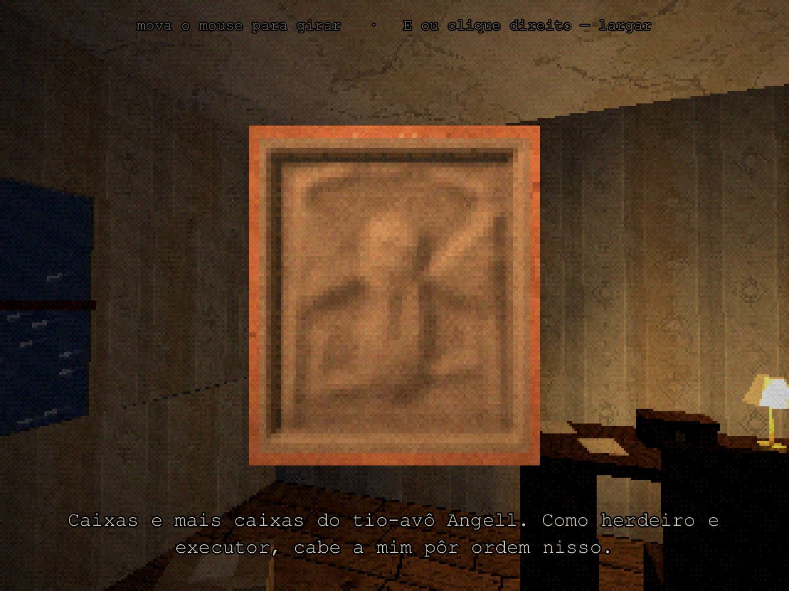
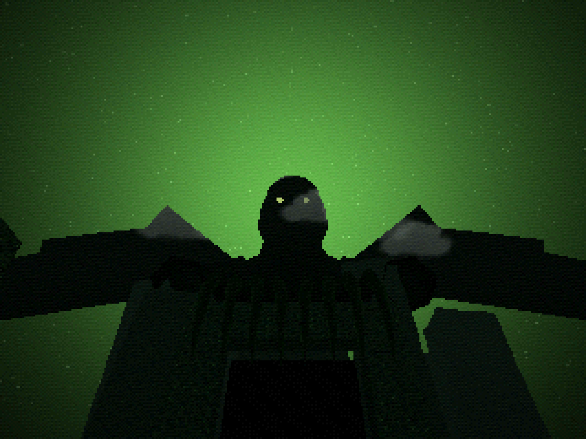

# CtHlUhU iS cAlLiNg YoU

Terror cósmico em primeira pessoa, sem combate, baseado em "The Call of Cthulhu" (1928), de H. P. Lovecraft.
O jogador vive Francis Wayland Thurston e termina diante de Cthulhu. Visual de PlayStation 1 em 320×240.

| Prólogo — Os Papéis | O ateliê de Wilcox |
|---|---|
|  |  |
| **Examinar: o baixo-relevo na mão** | **O Julgamento, aos 34 segundos** |
|  |  |

Este repositório é a **pré-produção** descrita no [documento de design](docs/GDD.md): o projeto Godot,
o shader PS1 numa sala de teste, os sistemas centrais, o prólogo e o ateliê de Wilcox em cenário cinza,
a Visão de Wilcox e um rascunho jogável do Julgamento, com sons e texturas provisórios.

## Como abrir e jogar

1. Instale o [Godot 4.7](https://godotengine.org/download) (versão padrão, sem .NET).
2. No Godot, **Importar** → escolha `project.godot` nesta pasta.
3. Aperte **F5** para jogar desde o início ou **F6** numa cena de `scenes/levels/` para jogar só aquele nível.

### Controles

| Ação | Teclado e mouse | Controle |
|---|---|---|
| Andar / olhar | WASD / mouse | analógico esquerdo / direito |
| Correr (poucos segundos) | Shift | L3 |
| Agachar | Ctrl ou C | R3 |
| Interagir, examinar, ler | E ou clique | A |
| Largar objeto / voltar | clique direito ou Esc | B |
| Fechar os olhos (segurar) | Espaço ou Q | gatilho esquerdo |
| Diário | Tab ou J | Select |
| Pausa | Esc | Start |

Ao examinar, mova o mouse para girar o objeto: há datas e nomes escondidos no verso.
Nos documentos, clique ou D vira a página, A volta, e Esc fecha.

### Atalhos de desenvolvimento (só em builds de depuração)

| Tecla | Efeito |
|---|---|
| F1 / F2 | Conhecimento +10 / −10 (para ver as faixas de corrupção) |
| F3 | mostra Conhecimento, faixa, olhos, nível e FPS |
| F5 | recarrega o nível no último ponto salvo |
| F8 | pula direto para o platô do Julgamento |

No título, **Capítulos (desenvolvimento)** abre qualquer nível, inclusive a sala de teste do visual PS1.

## O que já existe

- **Visual PS1**: mundo em 320×240 ampliado sem suavização, vértices presos à grade (tremor),
  textura afim, iluminação e neblina por vértice, cor de 15 bits com pontilhado Bayer 4×4, grão,
  vinheta e filtro de TV opcional (`shaders/`).
- **Thurston**: anda devagar, corre por 3 s e fica ofegante, não pula, agacha, examina objetos girando-os
  na mão e fecha os olhos (a tela escurece, o som abafa e as distorções somem).
- **Conhecimento oculto (0–100)** com as quatro faixas do documento: o canto do culto vai do inaudível
  ao nítido, esculturas mudam de pose fora da vista, tijolo vira escama por um instante, sombras de
  tentáculo na visão periférica, geometria errada e narração que perde o tom cético.
- **Documentos** em tela cheia (máquina de escrever, letra à mão, jornal), **diário** como lista de
  objetivos sem HUD, **legendas** sempre ligadas, **salvamento automático** em pontos fixos.
- **Prólogo — Os Papéis** jogável: carta, obituário, chaveiro do tio, caixa trancada, baixo-relevo
  com o verso riscado, manuscrito "CTHULHU CULT" e o baixo-relevo que muda de lugar na mesa.
- **Capítulo I** em cenário cinza: o ateliê de Wilcox (conversa, esboços, estátuas que se mexem,
  a peça mórbida) e a **Visão de Wilcox** (a cidade ciclópica e a voz que não é voz).
- **Ato final e Julgamento**: o barco nas coordenadas de Johansen, rampa que engana a câmera,
  corredor maior por dentro do que por fora e os 56 segundos do Julgamento seguindo o roteiro
  do documento segundo a segundo, com a silhueta de Cthulhu gerada por código (cerca de 1.300 triângulos).
- **Opções** de conforto: campo de visão, sensibilidade, tremor, deformação da textura, balanço da
  câmera, filtro de TV, legendas, dicas e volume.

O que falta, em ordem, está em [docs/ROADMAP.md](docs/ROADMAP.md).

## Testes

```bash
godot --headless --path . res://tests/test_runner.tscn
```

São 33 testes sem dependências externas. Eles conferem as regras do documento de design (faixas de
Conhecimento, no máximo duas frases por fala, linha do tempo do Julgamento, coração que para aos 40 s,
silhueta que nunca cabe na tela, limite de 3.000 triângulos, nenhum termo racial nos textos), a integridade
do conteúdo (toda fala, entrada de diário, dica e som citados existem) e jogam o roteiro inteiro do prólogo
ao fim do ateliê, e o Julgamento até os créditos. Para capturas de tela de revisão (abre uma janela):

```bash
godot --path . res://tests/capture.tscn -- --out=C:/capturas
```

## Sons e texturas provisórios

Tudo em `assets/audio/draft/` e `assets/textures/draft/` é rascunho gerado por código
(`node tools/gen_draft_audio.js` e `node tools/gen_draft_textures.js`). Para trocar um som pela gravação
definitiva, ponha um arquivo com o mesmo nome em `assets/audio/final/` (`.ogg` ou `.wav`): ele passa a
valer sem mexer no código. Falas gravadas vão em `assets/audio/final/voice/<id da fala>.ogg`
(os ids estão em [docs/ROTEIRO.md](docs/ROTEIRO.md)).

As fontes da interface vêm do sistema (Courier New, Ink Free, Georgia, com alternativas para Linux).
Para a versão final, vale incluir fontes livres como Special Elite ou Courier Prime e Homemade Apple.

## Documentação

- [docs/GDD.md](docs/GDD.md): o documento de design (cópia em Markdown).
- [docs/ARQUITETURA.md](docs/ARQUITETURA.md): como o projeto é organizado e como acrescentar níveis, falas, documentos e sons.
- [docs/CENAS_E_OBJETOS.md](docs/CENAS_E_OBJETOS.md): lista de cenários e objetos do jogo inteiro, com o estado de cada um.
- [docs/ROTEIRO.md](docs/ROTEIRO.md): todas as falas, anotações do diário e documentos.
- [docs/ROADMAP.md](docs/ROADMAP.md): fases de produção e próximos passos.

## Direitos

Lovecraft morreu em 1937. O conto está em domínio público no Brasil desde 2008 e nos EUA desde 2024.
Os textos do jogo são adaptações próprias em português. O título evita "Call of Cthulhu", marca usada
pela Chaosium em jogos. Isto é uma orientação geral, não um parecer jurídico: confirme antes de vender o jogo.
