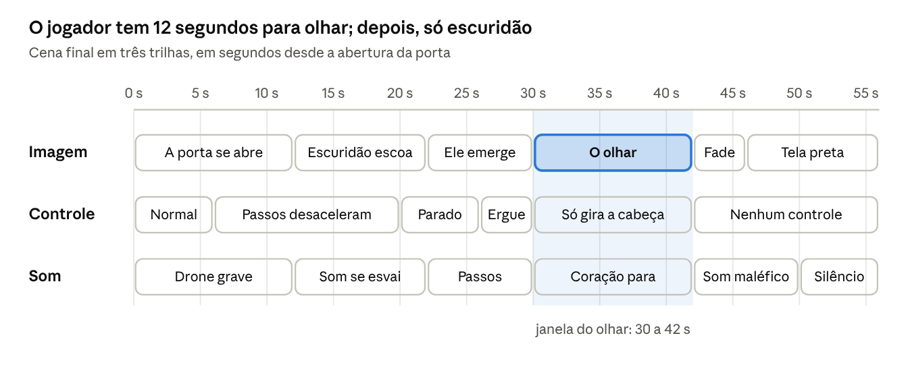

> Cópia em Markdown do documento original ("CtHlUhU iS cAlLiNg YoU — Documento de Design do Jogo.docx", 7 de outubro de 2026). Em caso de dúvida, vale o original.

# CtHlUhU iS cAlLiNg YoU — Documento de Design do Jogo

Oct 7, 2026 · @COLEGIO WR

## Visão geral

CtHlUhU iS cAlLiNg YoU é um jogo de terror cósmico em primeira pessoa, de 60 a 90 minutos, sem combate. O jogador vive Francis Wayland Thurston, o narrador de "The Call of Cthulhu" (1928), e termina diante de Cthulhu.

| Item | Definição |
|---|---|
| Título | CtHlUhU iS cAlLiNg YoU — no logo, as letras trocam de caixa e tremem, como texto corrompido |
| Gênero | Terror cósmico narrativo: exploração, leitura e tensão, sem combate |
| Plataforma | PC (Windows e Linux), lançamento inicial no itch.io |
| Duração | 60 a 90 minutos, para jogar em uma sessão |
| Estética | Low-poly no estilo PlayStation 1, resolução interna de 320×240 |
| Classificação sugerida | 16 anos (ritual, loucura, morte implícita) |
| Final | Único e fixo: Cthulhu aparece, o jogador só pode olhar, a tela escurece com um som maléfico |

#### Pilares de design

- Saber é o perigo. O jogador avança lendo e ligando pistas, e cada descoberta piora o mundo ao redor.
- Impotência. Não há armas, combate nem vitória; o único desfecho é o julgamento final.
- O indescritível. A baixa fidelidade esconde mais do que mostra, e a mente do jogador completa o horror.
- Fidelidade ao conto. Lugares, datas e nomes do texto original ancoram o pesadelo em 1925–1927.

## Base literária e adaptação

O jogo segue os três capítulos do conto e acrescenta um ato final que leva Thurston ao fim que o próprio texto anuncia. O conto se apresenta como "encontrado entre os papéis do falecido Francis Wayland Thurston, de Boston" — ou seja, o narrador já está morto quando lemos.

#### O conto em quatro movimentos

- I. O Horror em Argila. No inverno de 1926–27, Thurston herda os papéis do tio-avô, o professor George Gammell Angell, morto numa ladeira do porto de Providence após ser empurrado por um marinheiro. Numa caixa trancada estão um baixo-relevo de argila e o manuscrito "CTHULHU CULT".
- O sonho de Wilcox. O escultor Henry Anthony Wilcox fez o baixo-relevo dormindo, após um tremor de terra, e o levou a Angell em 1º de março de 1925. De 23 de março a 2 de abril ele delirou de febre, enquanto artistas do mundo todo sonhavam com a mesma cidade de pedra verde.
- II. O Relato do Inspetor Legrasse. Em 1º de novembro de 1907, a polícia de Nova Orleans invadiu um ritual nos pântanos e apreendeu uma estatueta. O prisioneiro Castro revelou que os Grandes Antigos dormem em R'lyeh e voltarão quando as estrelas estiverem certas.
- III. A Loucura Vinda do Mar. Num jornal de Sydney de 18 de abril de 1925, Thurston descobre o marinheiro norueguês Gustaf Johansen. O manuscrito dele, obtido com a viúva em Oslo, narra o desembarque em R'lyeh e o despertar de Cthulhu; Thurston termina certo de que será o próximo a morrer.

#### Decisões de adaptação

- O narrador é o jogador. Tudo o que Thurston investiga vira lugar visitável, documento ou visão jogável.
- Visões jogáveis. Ao tocar um objeto do culto (baixo-relevo, estatueta, manuscrito), Thurston revive a cena em primeira pessoa. No conto, Cthulhu fala aos sensíveis por sonhos; o jogo usa essa regra para levar o jogador ao pântano de 1907 e a R'lyeh sem trocar de protagonista.
- O ato final é a extrapolação. No conto, Thurston nunca vê Cthulhu. O jogo materializa a morte que ele pressente.
- Ambiguidade deliberada. Fica em aberto se Thurston chegou a R'lyeh ou morreu sonhando em Boston; as duas leituras levam ao mesmo fim.
- Sem o racismo do original. Lovecraft descreve os cultistas com preconceito racial explícito. No jogo, o culto é internacional e definido pelo que faz, nunca pela etnia.

## Protagonista: Francis Wayland Thurston

Thurston é um homem comum de Boston, herdeiro e executor do tio-avô, sem treino de detetive nem de luta. No começo ele é um cético que quer fama como antropólogo; no fim, sabe demais.
- Corpo frágil. Anda devagar, corre por poucos segundos antes de ficar ofegante e não pula.
- Voz. Narração em off curta, em tom de diário, com no máximo duas frases por vez. Ele fala nos momentos de virada, nunca para explicar a fase.
- Arco mental. A narração começa racional e debochada ("o rapaz deve ter inventado tudo") e perde a segurança à medida que o Conhecimento sobe.
- Diário. Cada pista vira uma anotação à mão, que funciona como lista de objetivos sem HUD.

Primeira fala do jogo, sobre tela preta, traduzida da abertura do conto:
"A coisa mais misericordiosa do mundo, penso eu, é a incapacidade da mente humana de correlacionar tudo o que contém."

## Estrutura narrativa

O jogo tem um prólogo, três capítulos fiéis ao conto e um ato final, somando cerca de 75 minutos. Cada capítulo termina numa visão jogável, e cada visão mostra um pouco mais da cidade, mas nunca Cthulhu.

| Fase | Onde e quando | Duração | O que o jogador faz | Pico de terror |
|---|---|---|---|---|
| Prólogo — Os Papéis | Aposentos de Thurston em Boston, inverno de 1926–27 | 8 min | Aprende a examinar e ler; abre a caixa trancada do tio | O baixo-relevo está em outro lugar da mesa quando ele volta |
| I — O Horror em Argila | Providence: ladeira do porto e Edifício Fleur-de-Lys (Thomas Street) | 15 min | Ordena relatos de sonhos por data; visita o ateliê de Wilcox | Visão do sonho de Wilcox: primeira olhada na cidade ciclópica |
| II — O Relato de Legrasse | Nova Orleans, 1927, com visão do pântano em 1º/11/1907 | 20 min | Examina a estatueta; atravessa o pântano seguindo os tambores | O círculo de cultistas vira a cabeça ao mesmo tempo para o jogador |
| III — A Loucura do Mar | Museu de Paterson (Nova Jersey), Oslo e o barco para Londres | 20 min | Liga a notícia do jornal ao manuscrito de Johansen e o lê | Visão de R'lyeh: a porta começa a abrir e a cena corta |
| Ato final — O Chamado | Boston, depois R'lyeh, a 47°9' S e 126°43' O | 12 min | Atravessa a cidade de ângulos impossíveis até a porta | O Julgamento (seção própria) |

### Prólogo — Os Papéis

- Tela preta, primeira fala, depois o quarto de Thurston cheio das caixas do tio, à noite, com chuva.
- Tutorial embutido: pegar, girar, ler e anotar no diário.
- A caixa trancada só abre com a chave do chaveiro que o tio levava no bolso. Dentro: o baixo-relevo (cerca de 13×15 cm) e o manuscrito "CTHULHU CULT".

### I — O Horror em Argila

- Na ladeira entre o porto e a Williams Street, onde Angell caiu, um marinheiro observa Thurston de longe e some.
- Mural de recortes: o jogador ordena relatos por data e percebe que todos se concentram entre 23 de março e 2 de abril de 1925.
- No ateliê do Fleur-de-Lys, Wilcox mostra uma estátua mórbida e diz que a geometria do lugar sonhado está "toda errada". Esculturas mudam de pose quando o jogador não olha.
- Visão de Wilcox: blocos titânicos de pedra verde escorrendo limo e uma voz que não é voz, repetindo "Cthulhu fhtagn".

### II — O Relato do Inspetor Legrasse

- No escritório de Legrasse, o jogador lê o depoimento do velho Castro, já morto, e ouve um cilindro de fonógrafo com o canto.
- Ao tocar a estatueta de pedra verde-escura, Thurston revive a noite de 1907: ciprestes, musgo pendurado, tambores e um clarão vermelho ao longe.
- Furtividade leve até a clareira: fogueira em anel, monólito de granito com a estatueta no topo, o culto girando ao redor.
- Ser visto acorda Thurston e reinicia a visão no último ponto, sem morte.
- Clímax: o canto completo, "Ph'nglui mglw'nafh Cthulhu R'lyeh wgah'nagl fhtagn", e todos os cultistas olhando para o jogador.

### III — A Loucura Vinda do Mar

- No depósito do museu de Paterson, o jornal Sydney Bulletin de 18/4/1925 está forrando uma prateleira de minerais, com a foto do ídolo.
- A viagem por São Francisco, Dunedin, Auckland e Sydney aparece em cartas, telegramas e fotos no diário, sem fases próprias.
- Em Oslo, a viúva de Johansen entrega o manuscrito; ele morreu atingido por um fardo de papéis que caiu de uma janela.
- No barco para Londres, Thurston lê o manuscrito com algodão nos ouvidos, porque não suporta o som da água no casco.
- Visão de Johansen: desembarque, ângulos que mudam de côncavo para convexo, a porta colossal começando a ceder — corte seco para Thurston acordando. Cthulhu não aparece.

### Ato final — O Chamado

- Boston, 1927: Thurston guarda tudo numa caixa de lata e escreve seu relato. O som de água pingando não para, e o quarto se deforma enquanto ele escreve.
- Ao adormecer, está num barco parado nas coordenadas do manuscrito, e R'lyeh sobe do mar.
- A subida usa espaços impossíveis: corredores maiores por dentro do que por fora, rampas que parecem subir mas descem, horizonte que não fica reto.
- No topo, a porta. Daí em diante vale o roteiro do Julgamento.

Alternativa mais literal: Thurston freta um barco em Dunedin e vai ao local acordado. Recomendo a versão em sonho, que custa uma fase a menos e preserva a ambiguidade.

## Mecânicas de jogo

O jogo se apoia em explorar, examinar, ler e num medidor oculto de Conhecimento. Não há combate, armas, barra de vida nem inventário de recursos.
- Controles. Teclado e mouse ou controle: andar, correr curto, agachar, interagir e fechar os olhos.
- Examinar. Objetos giram em 3D na mão; inscrições e datas escondidas só aparecem girando.
- Ler. Documentos em tela cheia, papel amarelado e fonte de máquina de escrever. Ler é opcional, mas alimenta o Conhecimento.
- Quebra-cabeças diegéticos. Ordenar recortes por data, encaixar fragmentos do baixo-relevo, achar as coordenadas no manuscrito, seguir o som dos tambores. Nenhum deve passar de 5 minutos.
- Falha sem morte. Ser pego numa visão faz Thurston acordar e retomar do último ponto. A única morte do jogo é a final.
- Salvamento automático em pontos fixos, sem save manual, para manter a tensão.

### Conhecimento (oculto, de 0 a 100)

O Conhecimento sobe a cada documento lido e visão vivida. Ele não pune o jogador; ele corrompe o mundo, aplicando o pilar "saber é o perigo".

| Conhecimento | O que muda no mundo |
|---|---|
| 0–25 | Mundo normal, sons ambientes discretos |
| 26–50 | O canto aparece no limite da audição; quadros e esculturas mudam de lugar fora da vista |
| 51–75 | Texturas trocam por um instante (tijolo vira escama); sombras com formato de tentáculo |
| 76–100 | Geometria errada em cômodos comuns; a narração de Thurston perde o tom cético |

### Fechar os olhos

Segurar o botão escurece a tela, abafa o som e faz as distorções do Conhecimento sumirem enquanto os olhos estão fechados. É o único refúgio do jogador: serve para atravessar trechos de alucinação, mas usá-lo demais faz perder o caminho.
No Julgamento, o botão para de funcionar — Thurston não consegue fechar os olhos. O jogador aprende o gesto durante o jogo inteiro para senti-lo falhar no fim.

## Direção de arte: baixa fidelidade proposital

A baixa qualidade é linguagem, não limitação: o jogo imita o PlayStation 1 para que o jogador nunca veja nada com nitidez. É o equivalente visual das descrições de Lovecraft, que dizem que a coisa "não pode ser descrita".

#### Por que assusta mais

- Formas imprecisas obrigam a mente a completar a imagem, e ela completa com o pior que imagina.
- Neblina curta e resolução baixa criam dúvida constante sobre o que está a dez metros.
- Texturas que tremem e polígonos que dançam já são desconfortáveis, como a geometria "errada" de R'lyeh.
- De quebra, o escopo de arte cabe numa equipe pequena.

#### Especificação técnica

| Elemento | Especificação |
|---|---|
| Resolução interna | 320×240 (4:3), ampliada sem suavização (nearest neighbor) |
| Vértices | Arredondados à grade da tela, com o tremor típico do PS1 |
| Texturas | 64×64 a 128×128 px, sem filtragem, com mapeamento afim (deformam em ângulos rasos) |
| Cores | 15 bits por pixel com dithering ordenado (matriz Bayer 4×4) |
| Polígonos | Cômodo inteiro 1.000–3.000; objetos 50–300; personagens 300–600; Cthulhu até 3.000 |
| Iluminação | Por vértice; o lampião é a única luz forte na maioria das cenas |
| Distância de visão | Neblina a 15–25 m em áreas abertas |
| Animação | Personagens a 12 quadros por segundo; câmera e jogador a 60 |
| Pós-processo | Grão leve e vinheta; filtro de TV de tubo opcional no menu |
| Interface | Sem HUD: só diário, documentos e um ponto de mira discreto |

#### Paleta por lugar

- Boston e Providence: azul-acinzentado e sépia, chuva constante, luz amarela de lampião.
- Pântano de 1907: verde-doente, preto e o laranja das fogueiras.
- Mar, navios e Oslo: cinza-chumbo e branco sujo.
- R'lyeh: verde-limo, preto e um céu com estrelas fora do lugar.

Regra de ouro: Cthulhu nunca aparece inteiro antes do Julgamento — nem em visões, menus ou telas de carregamento. O baixo-relevo e as estatuetas são pequenos e borrados o bastante para insinuar sem revelar.

## Design de som e voz

O som carrega metade do terror e segue a mesma lógica lo-fi da imagem: amostras de baixa qualidade, quase nenhuma música e muito silêncio.
- Formato. Efeitos a 22 kHz e voz levemente comprimida, como gravação antiga.
- Ambiências. Chuva e madeira rangendo em Boston e Providence; tambores, insetos e água parada no pântano; casco e ondas no mar; em R'lyeh, pressão abafada como debaixo d'água.
- Música. Quase nenhuma. Drones graves e acordes dissonantes entram só nas viradas de capítulo.
- O canto como tema. "Ph'nglui mglw'nafh Cthulhu R'lyeh wgah'nagl fhtagn" ("Em sua casa em R'lyeh, o morto Cthulhu espera sonhando") toca desde o prólogo, inaudível no começo e mais nítido conforme o Conhecimento sobe.
- Coração. O batimento de Thurston fica audível nos picos de medo. O jogador se acostuma a ele para notar quando ele para, no Julgamento.
- Água. Desde o capítulo III, um pingar de água persegue Thurston em qualquer cômodo, como o barulho do casco que ele não suportava.
- Sustos. No máximo três sustos de volume no jogo inteiro; o medo vem do pavor contínuo, não do pulo.
- Silêncio. Cortar todo o som por 2 a 3 segundos antes de cada momento-chave.
- Voz de Thurston. Em português, gravada pelo próprio autor ou por um dublador; legendas sempre ligadas por padrão.
- O som maléfico final está especificado em O Julgamento.

## O Julgamento: a cena final

A cena dura 56 segundos a partir da abertura da porta. O jogador perde o controle aos poucos até restar apenas olhar Cthulhu por 12 segundos; não há ataque nem ação, e a tela escurece com um som maléfico.

#### Roteiro, momento a momento

- A porta se abre (0–12 s). No platô, a porta colossal cede pelo topo e recua na diagonal, sem que dê para dizer se é vertical ou horizontal. Os passos de Thurston começam a pesar aos 6 s.
- A escuridão escoa (12–22 s). Uma escuridão quase sólida sai como fumaça, em partículas de baixa resolução, e escurece o céu. O som ambiente se esvai, e o jogador para aos 20 s, sem aviso.
- Ele emerge (22–30 s). Tremor e um som úmido e arrastado. Garras maiores que prédios agarram o batente, e algo começa a subir por trás da cidadela, apagando as estrelas. A câmera é puxada para cima sozinha: Thurston ergue a cabeça.
- O olhar (30–42 s). Cthulhu, imóvel e grande demais para caber na tela: o corpo escamoso some na neblina, as asas cobrem o horizonte, e a cabeça de polvo, inclinada como na estatueta, encara Thurston do alto, entre nuvens. O jogador só gira a cabeça num cone pequeno, e o botão de fechar os olhos não responde. O coração desacelera e para aos 40 s.
- O fim (42–46 s). Sem ataque e sem movimento da entidade, a imagem escurece em 4 segundos enquanto o som maléfico toca.
- Tela preta (46–56 s). Silêncio total a partir dos 50 s. Depois, os créditos — ou, opcionalmente, uma única linha: "Encontrado entre os papéis do falecido Francis Wayland Thurston, de Boston."

#### A silhueta: grande demais para medir

Cthulhu deve parecer quase imensurável: o jogador nunca consegue enquadrá-lo inteiro, e a mente completa o que fica fora da tela. Referência de escala: imagem enviada.
- Nunca cabe no quadro. O cone de câmera do Julgamento é calculado para que a silhueta sempre transborde as bordas da tela, mesmo com a cabeça erguida ao máximo.
- Um buraco no céu. Ao subir, ele apaga as estrelas; o contorno é o recorte escuro no céu, com um contraluz verde-doente atrás.
- Perspectiva atmosférica. A base é nítida, o tronco fica leitoso e a cabeça aparece entre nuvens; a neblina diz ao olho que as partes de cima estão a quilômetros.
- Réguas de escala. A porta, que no conto tem cerca de um acre, e os monólitos da cidadela ficam do tamanho das garras dele. O barco de Thurston, lá embaixo, é um ponto.
- Lentidão. Coisas gigantes se movem devagar: um único gesto de tentáculo leva vários segundos, a 12 quadros por segundo.
- Som atrasado. Cada movimento chega ao ouvido um instante depois de visto, como um trovão distante.
- Quase sem paralaxe. Ao girar a cabeça, ele mal se desloca contra o fundo, como uma montanha no horizonte.
- Técnica. Malha de até 3.000 triângulos renderizada como camada de fundo, em escala de céu, com o detalhe concentrado no contorno: tentáculos, asas e garras. O brilho úmido verde aparece só nas partes mais próximas.

O som maléfico (42–50 s): um pulso subgrave, o canto do culto tocado de trás para frente e um rugido orgânico rebaixado de tom, cortados de uma vez para o silêncio.

## Documentos e narrativa ambiental

Os documentos contam a história: dá para terminar o jogo lendo pouco, mas só se entende tudo lendo tudo. Todos são adaptados do texto do conto, em domínio público.

| Documento | Onde aparece | O que revela |
|---|---|---|
| Manuscrito "CTHULHU CULT" de Angell | Prólogo | A investigação que provavelmente matou o tio |
| Registro dos sonhos de Wilcox | Prólogo e cap. I | A cidade de pedra verde e as palavras "Cthulhu" e "R'lyeh" |
| Relatos de sonhos e recortes de jornal | Cap. I | Artistas e sensitivos do mundo todo sonharam no mesmo período de 1925 |
| Notas do congresso de St. Louis (1908) | Cap. II | A estatueta de Legrasse e o ídolo igual que o professor Webb viu na Groenlândia em 1860 |
| Depoimento do velho Castro | Cap. II | Os Grandes Antigos, R'lyeh submersa e o retorno quando as estrelas estiverem certas |
| Sydney Bulletin de 18/4/1925 | Cap. III | O iate Alert à deriva e o único sobrevivente, Johansen |
| Cartas e telegramas da viagem | Cap. III | Dunedin, Auckland e Sydney: o culto no cais e o ídolo maior no museu |
| Manuscrito de Johansen | Cap. III | O desembarque em R'lyeh, as coordenadas e a coisa que saiu da porta |
| Relato de Thurston | Ato final | O texto que o próprio jogador "escreve" enquanto o quarto se deforma |
| Diário de Thurston | Jogo inteiro | Resumo das pistas e o estado mental do protagonista |

Narrativa ambiental: marcas de lama e água em lugares secos, o mesmo marinheiro visto em cidades diferentes, e o símbolo do baixo-relevo riscado em portas e janelas que Thurston visita.

## Produção: ferramentas, escopo e cronograma

Para uma pessoa em meio período, a meta realista é uma fatia jogável em 6 semanas e o jogo completo em 6 a 8 meses. Se o prazo apertar, a versão mínima de 30 minutos sai em cerca de 3 meses.

| Função | Ferramenta sugerida | Por quê |
|---|---|---|
| Motor | Godot 4 | Gratuito e leve; shaders simples resolvem tremor de vértices, textura afim e dithering |
| Alternativa de motor | Unity | Muitos pacotes prontos de visual PS1 |
| Modelagem 3D | Blender | Gratuito, ótimo para low-poly |
| Texturas | Krita (gratuito) ou Aseprite (pago) | Pixel art e paleta reduzida |
| Som | Audacity (gratuito) ou Reaper | Edição, redução de taxa de amostragem e reverb |
| Versionamento | Git + GitHub | Histórico e backup do projeto |

#### Fases de produção

- Pré-produção (2 semanas): roteiro final das falas, lista de cenários e objetos, shader PS1 funcionando numa sala de teste.
- Fatia vertical (4 semanas): Prólogo e Capítulo I completos, com som, diário e Conhecimento.
- Teste do final (1 semana, cedo): um rascunho do Julgamento em cenário cinza, para validar o ritmo antes de produzir o resto.
- Produção (4 a 5 meses): Capítulos II e III e o Ato final.
- Polimento e testes (3 a 4 semanas): ritmo, acessibilidade e 5 a 10 jogadores de teste.

Escopo mínimo, se faltar tempo: Prólogo, Capítulo I e Ato final, cerca de 30 minutos. Os capítulos II e III viram documentos e uma única visão curta do pântano.

## Riscos e cuidados

O maior risco é o escopo: são muitos lugares para uma equipe pequena. O segundo é o final frustrar quem espera reagir; ele precisa ser preparado ao longo do jogo.

| Risco | Como reduzir |
|---|---|
| Escopo grande demais | Começar pela versão mínima; viagens só como documentos |
| Final frustrar o jogador | Ensinar desde cedo o corpo frágil, o botão de fechar os olhos e as visões que cortam antes do clímax |
| Enjoo com tremor de vértices e balanço de câmera | Opções de campo de visão, intensidade do tremor e balanço da câmera |
| Fotossensibilidade | Nada de flashes rápidos; aviso na abertura |
| Racismo do texto original | Culto internacional sem marcadores étnicos; nenhum NPC definido pela origem |
| Violência do ritual de 1907 | No conto há corpos pendurados ao redor da fogueira: mostrar só de longe, em silhueta, e manter a classificação de 16 anos |
| Direitos e marca | Lovecraft morreu em 1937, e no Brasil a obra está em domínio público desde 2008; nos EUA, o conto (1928) está livre desde 2024. Evitar "Call of Cthulhu" no título, marca usada pela Chaosium em jogos, e não copiar visuais de adaptações modernas |

A linha de direitos é uma orientação geral, não parecer jurídico; vale confirmar antes de vender o jogo.

## Referências e próximos passos

#### Para estudar

- Iron Lung (David Szymanski, 2022): terror curto, visão limitada e final seco.
- Jogos da Puppet Combo e coletâneas Haunted PS1: a estética PS1 aplicada ao terror.
- Bloodborne PSX (Lilith Walther, 2022): horror lovecraftiano em visual de PS1.
- Amnesia: The Dark Descent (2010): terror em primeira pessoa sem combate.
- Call of Cthulhu: Dark Corners of the Earth (2005): Lovecraft em primeira pessoa e uso de sanidade.
- Filme The Call of Cthulhu (H. P. Lovecraft Historical Society, 2005): adaptação fiel feita de propósito como filme mudo, prova de que a técnica "pobre" serve ao terror.

#### Próximos passos

- ☐ Criar o logo com as letras trocando de caixa, como texto corrompido
- ☐ Confirmar o motor e testar o shader PS1 numa sala de teste
- ☐ Montar em cenário cinza os aposentos de Thurston e o ateliê de Wilcox
- ☐ Modelar a silhueta de Cthulhu e testar o Julgamento cedo
- ☐ Gravar rascunhos do canto, do coração e do som maléfico

#### Fontes

- "The Call of Cthulhu", texto integral no H. P. Lovecraft Archive
